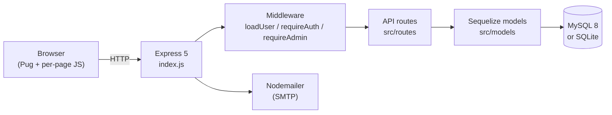
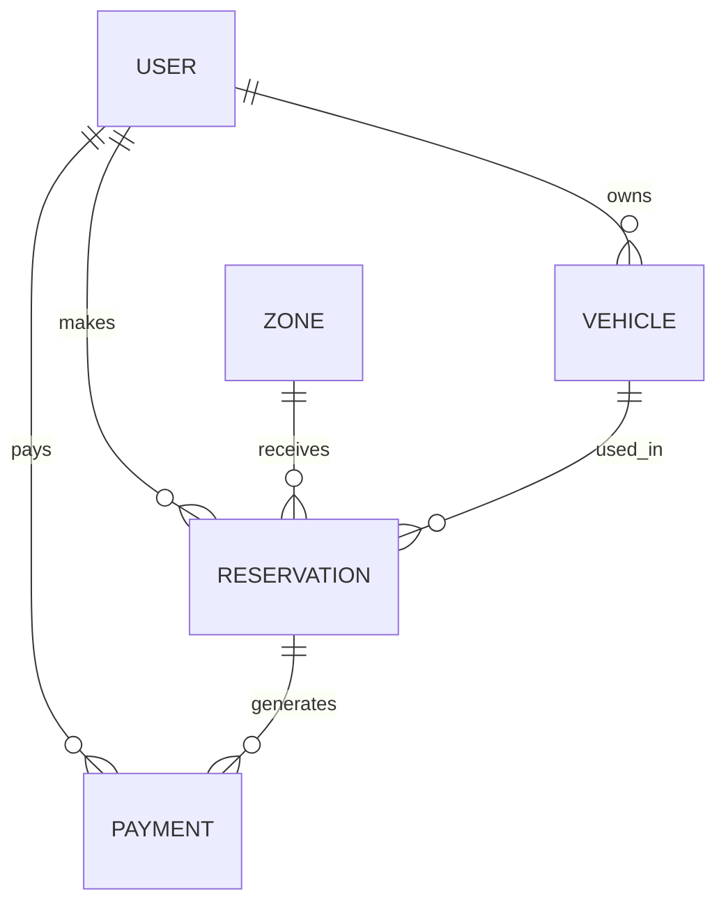

# Architecture

## Overview

A monolithic, server-rendered application:

## Data model

| Table | Key fields |
| --- | --- |
| `users` | `id`, `name`, `email` (unique), `password` (bcrypt hash), `role` (`Ciudadano` / `Administrador`), `active` |
| `zones` | `id` (string), `name`, `address`, `price`, `availableSpots`, `totalSpots`, `schedule` |
| `vehicles` | `id`, `plate`, `brand`, `model`, `year`, `userId` |
| `reservations` | `id`, `hours`, `amount`, `startsAt`, `endsAt`, `vehiclePlate`, `status` (`pendiente` / `pagada` / `cancelada`) |
| `payments` | `id`, `reference`, `reservationId`, `userId` |

> Role and status values (`Ciudadano`, `Administrador`, `pendiente`, `pagada`, `cancelada`) are stored in Spanish, exactly as used in the code.

Delete rules:

- Deleting a user deletes their vehicles, reservations, and payments (`CASCADE`).
- Deleting a vehicle keeps the history: `vehicleId` becomes `NULL` and the plate is preserved in `vehiclePlate`.
- A zone that has reservations cannot be deleted (`RESTRICT`).

## Authentication and roles

- Session uses a JWT (8 h) in the `sigmui_session` cookie (`httpOnly`, `sameSite=lax`, `secure` in production).
- The token only stores the `id`. Name, role, and status are read from the database on every request, so a role change or deactivation takes effect immediately.
- Middleware: `requireAuth` (any user) and `requireAdmin` (administrators only).
- Public sign-up always creates a `Ciudadano` (citizen) user.

## Routes

### Views

| Route | Access |
| --- | --- |
| `/`, `/auth/login`, `/auth/register`, `/auth/forgot-password` | Public |
| `/zonas`, `/vehicles`, `/pagos`, `/reservas/cancelar`, `/reservas/historial`, `/configuracion` | Authenticated |
| `/admin/usuarios` | Administrator |

### API

| Method and route | Access | Description |
| --- | --- | --- |
| `POST /api/auth/register` | Public | Citizen sign-up |
| `GET /api/zones` | Public | List zones |
| `PUT /api/settings/profile`, `PUT /api/settings/password` | Authenticated | Profile and password |
| `GET/POST/PUT/DELETE /api/vehicles` | Authenticated | The user's vehicles |
| `GET /api/reservations` | Authenticated | The user's reservations |
| `POST /api/payments` | Authenticated | Create a reservation and payment |
| `POST /api/reservations/:id/cancel` | Authenticated | Cancel and release the spot |
| `PUT /api/admin/zones` | Administrator | Rates and schedules |
| `GET/PUT/DELETE /api/admin/users` | Administrator | User management |

> This table is maintained by hand. When you add or change a route, update it in the same Pull Request.

## Design decisions

Important decisions are recorded in `docs/decisions/` using the [ADR](https://adr.github.io/) format: one short file per decision (context, decision, consequences).

